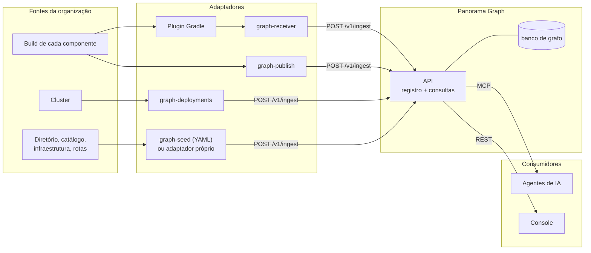

<p align="center"></p>

# Panorama Graph

API estruturada para registrar e consultar os relacionamentos da arquitetura e da estrutura organizacional de uma empresa, feita para agentes de IA consultarem e citarem. Usa um banco de grafo como armazenamento e define o modelo de persistência e as operações de consulta. Alimentada pelas fontes da própria organização, responde quem são as pessoas e os times, de que cada time é dono, quais componentes existem, como se ligam e o que roda em cada ambiente, com a fonte e a evidência de cada resposta.

- [Motivação](#motivação)
- [Como funciona](#como-funciona)
- [Operações](#operações)
- [Início rápido](#início-rápido)
- [Estrutura do repositório](#estrutura-do-repositório)
- [Repositórios relacionados](#repositórios-relacionados)
- [Documentação](#documentação)
- [Licença](#licença)

## Motivação

Agentes de IA que planejam, especificam e constroem software numa empresa não sabem o que já existe nela. Sem esse contexto, cada iniciativa começa do zero: o agente supõe a stack, inventa integrações, assume um provedor de nuvem que a empresa não usa e deixa em branco quem é dono do quê.

Dar ao agente acesso aos repositórios para que ele leia o código não resolve:

- **Escala e custo.** Uma organização tem centenas de repositórios. Cada pergunta viraria uma varredura, e o contexto do agente é o recurso mais caro que há.
- **O código não diz tudo.** A versão efetiva de cada dependência, a interface depois das anotações e configurações, a coleção realmente mapeada: isso só se resolve no build. O que está em produção, e em que versão, não está no código.
- **Há peças que não aparecem em código.** Gateways, brokers, bancos gerenciados e compartilhados, regras de roteamento: existem na plataforma, em manifestos de infraestrutura ou num CMDB, muitas vezes em nenhum repositório que o time veja.
- **A organização não está no código.** Em que time uma pessoa está, como os times se agrupam e quem é dono de cada componente vive no diretório corporativo e no catálogo de serviços.

Além disso, o que o agente deduz lendo é um palpite sem proveniência: ele não sabe dizer de onde tirou, nem separar o que viu do que supôs. Uma wiki ou uma base de conhecimento pode responder sobre padrões, convenções e **como se deve fazer**. O Panorama Graph responde **o que existe, quem é dono e como as partes se ligam**, de um jeito que o agente pode **citar em vez de supor**.

Um exemplo do contexto que faz diferença: ao atender uma pessoa, o agente precisa saber em que time ela trabalha, onde esse time está na organização e quais componentes são relevantes para ela: o que o time é dono, o que esses componentes consomem, quem os consome, que bancos e eventos tocam. Com isso, uma iniciativa nova já nasce ligada ao que existe.

## Como funciona

O Panorama Graph não contém dados de nenhuma organização nem descobre a arquitetura sozinho. O que ele oferece é a base estruturada: um modelo de nós e relações com proveniência obrigatória, uma API de registro para persistir os fatos e operações de consulta com nome, parâmetros e resposta definidos, servidas por MCP e por REST.



A API nunca lê uma fonte. Entre cada fonte e a API há um adaptador, que lê a fonte, traduz o que viu em nós e relações com proveniência e envia um retrato completo do seu escopo. Uma fonte nova entra com um adaptador novo, sem mudar o núcleo. O repositório [adapters](https://github.com/panorama-graph/adapters) traz os adaptadores prontos e uma organização de exemplo; o [SDK](sdks/typescript/README.md) e o [guia de adaptador](api/ADAPTADOR.md) servem para escrever os da sua organização.

### Fontes de dados

| Assunto | O que entra no grafo | De onde vem |
|---|---|---|
| Organização | Grupos, níveis da estrutura, pessoas e a hierarquia entre grupos | Diretório (IdP, RH), por adaptador próprio ou carga em YAML |
| Catálogo | Domínios, sistemas e donos de cada componente e API | Catálogo de serviços ou CMDB, por adaptador próprio ou carga em YAML |
| Build de cada componente | Repositório, stack, bibliotecas, APIs e endpoints com contrato, eventos publicados e consumidos, APIs consumidas, datasets lidos e escritos | Artefatos do build (manifesto, SBOM, OpenAPI, AsyncAPI, clientes HTTP, acesso a dados, Pact), publicados pelo plugin Gradle ou pelo `graph-publish` no pipeline |
| Implantações | O que roda em cada ambiente, em que versão e commit | Cluster, pelo `graph-deployments` |
| Infraestrutura e rotas | Ambientes, bancos, brokers, gateways, rotas de entrada | Inventário da plataforma e manifestos de ingress, por adaptador próprio ou carga em YAML |
| O que ainda não tem adaptador | Qualquer assunto | Carga em YAML pelo `graph-seed`, ou carga por agente de IA (sempre como `inferred`) |

### Conceitos centrais

- **Chave com prefixo.** Todo nó é identificado por `<prefixo>:<identificador>`, como `component:acme/credito/loan-simulation-api` ou `group:credito`. O prefixo diz o tipo, então uma relação pode apontar para um nó que ninguém declarou ainda, e a ordem das cargas não importa. As receitas de chave estão no SDK, para que fontes diferentes cheguem ao mesmo nó.
- **Afirmação.** A unidade de informação não é o nó nem a relação: é a afirmação de uma fonte sobre eles, com escopo, evidência (`repo@sha:caminho`), data, estado (`observed`, `inferred`, `confirmed`) e vigência (`current`, `stale`). A mesma relação afirmada por duas fontes são duas afirmações, devolvidas lado a lado.
- **Retrato por fonte e escopo.** Cada carga envia tudo o que a fonte afirma sobre um escopo (um componente, um namespace do cluster). O que estava no retrato anterior e não veio no novo vira `stale`, com a última data em que foi visto.

O modelo completo está em [MODELO.md](api/MODELO.md) e as regras de proveniência em [PROVENIENCIA.md](api/PROVENIENCIA.md).

### Por que um grafo e por que operações

**Um grafo** porque as perguntas que importam são perguntas de relação e de caminho: "o que é relevante para esta pessoa" atravessa pessoa, time, componentes do time, APIs que eles oferecem e quem as consome; "quais frontends dependem de X" passa por intermediários; "quem mais acessa este banco" parte de um recurso e volta aos componentes. Num grafo, a vizinhança de um nó e o caminho entre dois nós são as operações naturais. Várias fontes falam do mesmo nó (o catálogo diz quem é o dono, o build diz o que o componente consome, o cluster diz onde ele roda): cada fonte grava a sua própria relação, lado a lado com as outras, e a divergência fica visível.

**Operações com nome, e não acesso direto ao banco,** porque, com uma linguagem de consulta livre, o agente gasta contexto descobrindo o esquema, erra a consulta, traz resultados grandes demais e não aplica as regras que tornam a resposta correta: o que ainda vale e o que já saiu, a versão que roda em cada ambiente, a proveniência de cada fato. Cada operação do Panorama Graph já aplica vigência, ambiente e limite de tamanho, e devolve a fonte de cada relação. A consulta livre existe, só de leitura e cercada, para o que nenhuma operação cobre.

### Características

- **Visão dos times:** níveis da organização, grupos e pessoas, e quem é dono de cada domínio, sistema, componente e API.
- **Visão da arquitetura:** domínios, sistemas e componentes; APIs, endpoints, eventos e contratos; bancos e quem os acessa; bibliotecas e tecnologias; rotas de entrada e o que roda, em que versão, em cada ambiente.
- **Fato sem proveniência é recusado na entrada.** Toda resposta devolve a fonte, a evidência e o estado de cada relação.
- **Fontes que discordam ficam lado a lado:** uma fonte não sobrescreve a outra, e a divergência entre elas é consultável (`fact_divergences`).
- **Observado, inferido, confirmado:** fontes determinísticas gravam `observed`; o que um agente de IA deduz entra como `inferred` e nunca derruba um fato observado; só uma pessoa passa um fato para `confirmed`.
- **Dependência separada do caminho de rede:** quem depende de quem (`CONSUMES`, `CALLS`) não se confunde com por onde a requisição passa (`ROUTES`), e um gateway no meio não esconde a dependência real.
- **Console web:** mostra o mesmo grafo, com as fontes e as divergências, pelas mesmas consultas dos agentes, para quem precisa conferir e confiar no que eles consultam.

O que o Panorama Graph não é (portal de desenvolvedor, APM, CMDB, catálogo de dados) e as inspirações estão em [PROPOSITO.md](api/PROPOSITO.md).

## Operações

O grafo existe para responder perguntas como estas:

- Em que time esta pessoa está, onde o time fica na organização e quais componentes, APIs e bancos são relevantes para ela?
- Quem chama a API X? De quais endpoints o frontend Y depende?
- Quem publica e quem consome o evento Z, e qual é o contrato?
- Quem é dono deste componente, em que domínio e sistema ele está?
- Qual é a stack dele? Quais componentes usam a biblioteca L abaixo da versão V?
- Que banco ele usa e quem mais acessa esse banco?
- Por onde passa uma requisição para este endereço?
- O que está em produção e já saiu do código, ou entrou depois?

Cada operação responde a um tipo de pergunta, já aplicando vigência, ambiente e limite de tamanho, e devolve a fonte de cada relação:

| Para responder | Operações |
|---|---|
| Visão geral e busca | `architecture_overview`, `nodes_find`, `node_get` |
| Times e pessoas | `org_structure`, `people_list` |
| Componentes | `components_list`, `component_get`, `component_dependencies`, `component_compare`, `component_libraries` |
| Quem usa o quê | `api_consumers`, `contract_get`, `topic_get`, `dataset_get`, `library_usage`, `route_get` |
| Confiança nas fontes | `sources_status`, `fact_divergences` |
| Consulta livre, só leitura | `graph_query` |

As mesmas operações estão disponíveis no MCP (`/mcp`) e no REST (`POST /v1/queries/<operação>`, com OpenAPI em `/v1/openapi.json`).

Exemplo: trecho da resposta de `api_consumers` para o `product-catalog-api` da organização de exemplo. O `loan-simulation-api` consome a API, e duas fontes independentes afirmam isso, cada uma com a sua evidência.

```json
{
  "component": { "key": "component:acme/credito/loan-simulation-api", "name": "loan-simulation-api" },
  "consumes": [{
    "type": "CONSUMES",
    "node": { "key": "api:product-catalog/http", "name": "Product Catalog API" },
    "facts": [
      { "source": "pact", "state": "observed", "status": "current", "observedAt": "2026-10-01T00:00:00.000Z",
        "evidence": "acme/credito/loan-simulation-api@edf89ec…:build/architecture/pacts/loan-simulation-api-product-catalog.json" },
      { "source": "http-clients", "state": "observed", "status": "current", "observedAt": "2026-10-01T00:00:00.000Z",
        "evidence": "acme/credito/loan-simulation-api@edf89ec…:src/main/java/…/catalog/CatalogApi.java" }
    ]
  }]
}
```

## Início rápido

Requisitos: Docker e Docker Compose.

```sh
cp .env.example .env
docker compose up -d --build
```

| Serviço | Endereço |
|---|---|
| Console | <http://localhost:5180> |
| API (REST em `/v1`, MCP em `/mcp`) | <http://localhost:3200> |
| Neo4j Browser | <http://localhost:7474> (usuário `neo4j`, senha do `.env`) |

A instância sobe vazia. Para carregar a organização de exemplo e receber os builds, suba também o repositório [adapters](https://github.com/panorama-graph/adapters), conforme o [PRIMEIROS-PASSOS.md](PRIMEIROS-PASSOS.md).

Para conectar um agente, registre o servidor MCP no cliente. No Claude Code:

```sh
claude mcp add --transport http panorama-graph http://localhost:3200/mcp
```

> **Autenticação:** sem SSO configurado, a instância é anônima (o console abre sem login e quem alcança a API consulta o grafo), e um `INGEST_TOKEN` protege a escrita. Para expor fora de uma rede de confiança, ligue o login pelo SSO da organização (OIDC), como nos [primeiros passos](PRIMEIROS-PASSOS.md#6-autenticação).

## Estrutura do repositório

Workspace do pnpm (Node.js) com a API, o console e o SDK. Uma mudança no modelo chega aos três no mesmo commit.

| Pasta | Conteúdo |
|---|---|
| [api](api/README.md) | Modelo, registro com proveniência, consultas (MCP e REST) e o contrato de onde os SDKs são gerados |
| [web](web/README.md) | Console web para consultar o grafo e conferir as fontes |
| [sdks/typescript](sdks/typescript/README.md) | SDK em TypeScript (`@panorama-graph/sdk`): tipos e modelo gerados do contrato, receitas de chave e cliente do REST. É o pacote publicado para quem escreve um adaptador |

## Repositórios relacionados

| Repositório | Conteúdo |
|---|---|
| [adapters](https://github.com/panorama-graph/adapters) | Adaptadores que alimentam o grafo: `graph-publish` (a arquitetura do build, no CI de cada componente), `graph-deployments` (o que roda em cada ambiente, lido do cluster), `graph-seed` (retratos em YAML, para carga manual) e `graph-receiver` (recebe os pacotes de build do plugin Gradle). Inclui os formatos dos artefatos de build (`schemas/`), a organização de exemplo e o `example-seed`, ponto de partida para o adaptador de uma organização |
| [gradle-plugin](https://github.com/panorama-graph/gradle-plugin) | Plugin Gradle `panorama-graph` e biblioteca de teste para Spring: geram em `build/architecture` o que o build sabe do componente e o enviam ao receptor |
| [skills](https://github.com/panorama-graph/skills) | Skills para agentes de IA. A `panorama-graph-ingestao` conhece o modelo, explica o que pode ser importado e alimenta o grafo pela ingestão nativa, com o que o agente lê no código e nos acessos que tiver, sem modificar nada. A `panorama-graph-carga-manual` gera os artefatos de build de repositórios que ainda não usam os adaptadores e os importa pelo receptor |

Os repositórios relacionados dependem apenas do SDK e do contrato da API publicados por este.

## Documentação

| Documento | Assunto |
|---|---|
| [PRIMEIROS-PASSOS.md](PRIMEIROS-PASSOS.md) | Subir, carregar o exemplo e consultar; a primeira carga da sua organização |
| [ADOCAO.md](ADOCAO.md) | Levar o grafo a uma organização: convenções, ordem de implantação, pipeline, cluster e conferência |
| [MODELO.md](api/MODELO.md) | Nós e relações, o que é fixo e o que é livre, e o que fazer quando algo não cabe |
| [PROVENIENCIA.md](api/PROVENIENCIA.md) | Regras de proveniência e ciclo de vida dos fatos |
| [ADAPTADOR.md](api/ADAPTADOR.md) | Escrever um adaptador sem o SDK, com as receitas de chave e um exemplo de carga para cada relação |
| [PROPOSITO.md](api/PROPOSITO.md) | Por que o projeto existe e o que ele não é |
| [ROADMAP.md](ROADMAP.md) | O que já existe e o que vem pela frente |
| [AGENTS.md](AGENTS.md) | Guia de contribuição e de trabalho no repositório |

## Licença

Distribuído sob a [Sustainable Use License 1.0](LICENSE), inclusive o SDK publicado. Em resumo: uso e modificação dentro da própria organização, ou para fins pessoais e não comerciais, são livres. Não é permitido vender o Panorama Graph nem oferecê-lo a terceiros como produto ou serviço. Redistribuições devem ser gratuitas, para fins não comerciais, mantendo a licença e os avisos de autoria. O texto completo, que é o que vale, está em [LICENSE](LICENSE).
